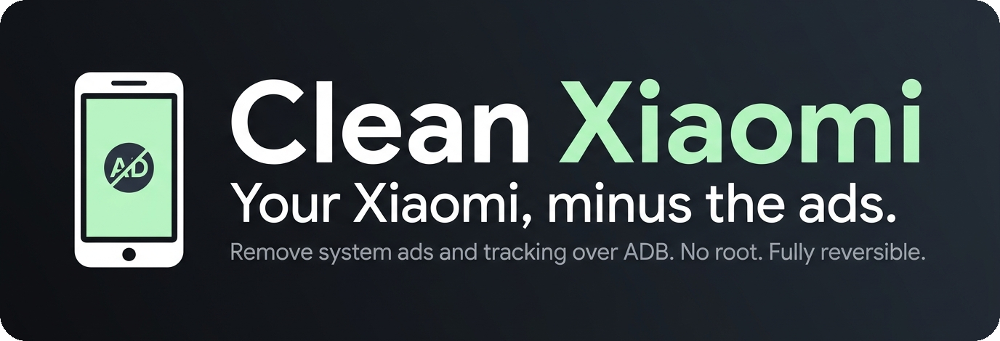

<p align="center"></p>

<p align="center">
  <a href="README.md">English</a> · <b>Русский</b>
</p>

Убираем системную рекламу, аналитику и предустановленный мусор на **вашем** Xiaomi / Redmi / POCO
(MIUI и HyperOS) через ADB. Без root, без разблокировки загрузчика, с бэкапом и откатом одной командой.

Два способа:

- **С ИИ-агентом** (Claude Code, Codex и т. д.): откройте папку и вставьте промпт из [`PROMPT.md`](PROMPT.md).
- **Обычными скриптами**: `backup` → `apply` → `restore` для Windows (PowerShell) или Linux/macOS (bash).

> **Честный статус:** метод проверен на одном телефоне (Redmi 9, MIUI 12). Названия пакетов зависят от модели,
> региона и версии системы, поэтому на других телефонах возможны правки. Начните с ступени 1 и
> [добавьте своё устройство](CONTRIBUTING.md).

<table align="center">
  <tr>
    <td align="center"><h2>1</h2>ПРОВЕРЕННОЕ УСТРОЙСТВО</td>
    <td align="center"><h2>2</h2>СТУПЕНИ БЕЗОПАСНОСТИ</td>
    <td align="center"><h2>0</h2>ROOT НЕ НУЖЕН</td>
    <td align="center"><h2>2</h2>ЯЗЫКА</td>
  </tr>
</table>

<h3 align="center">До и после</h3>

<table align="center">
  <tr>
    <td align="center"><b>ДО</b></td>
    <td></td>
    <td align="center"><b>ПОСЛЕ</b></td>
  </tr>
  <tr>
    <td></td>
    <td align="center">→</td>
    <td></td>
  </tr>
</table>

<!-- Блок «О нас пишут»: добавьте сюда реальные ссылки на публикации, когда они появятся. -->

## Быстрый старт

**1. Подготовьте телефон (один раз)**
1. Настройки → О телефоне → 7 раз нажмите на **версию MIUI / ОС**.
2. Настройки → Дополнительные настройки → Для разработчиков → включите **Отладку по USB**.
3. Установите [Android platform-tools](https://developer.android.com/tools/releases/platform-tools) на компьютер.
4. Подключите телефон, разрешите отладку на экране и выполните `adb devices` — должно быть `device`.

**2. Запуск (Windows PowerShell)**
```powershell
.\scripts\backup.ps1                                      # сохраняет данные устройства и список пакетов
.\scripts\apply.ps1 -List .\packages\tier1-ads.txt            # пробный запуск, ничего не меняет
.\scripts\apply.ps1 -List .\packages\tier1-ads.txt -Yes       # применить ступень 1 (реклама и аналитика)
```
> Если PowerShell блокирует скрипт: `Set-ExecutionPolicy -Scope Process Bypass` (только для этого окна).
> Если `adb` не найден, откройте PowerShell в папке platform-tools или добавьте её в PATH.

**Linux / macOS**
```bash
./scripts/backup.sh
./scripts/apply.sh packages/tier1-ads.txt
./scripts/apply.sh packages/tier1-ads.txt --yes
```

**3. Перезагрузите телефон** и проверьте звонки, интернет, уведомления, камеру.

**4. Откат**
```powershell
.\scripts\restore.ps1 -Log "$HOME\cleanxiaomi-backups\changes-ГГГГММДД-ЧЧММСС.log"
```

**5. Выключите отладку**: `adb shell settings put global adb_enabled 0`

## Настройки без ADB

- Настройки → Пароли и безопасность → Конфиденциальность → **Рекламные услуги** → выключить персональную рекламу.
- Пароли и безопасность → Авторизация и отзыв → отозвать **msa**, если есть в списке.
- Экран блокировки → Карусель обоев → выключить.
- В «Безопасности», «Темах», GetApps, Музыке, Браузере выключите «рекомендации».

## Как это работает

Магии нет: у любого Android есть Android Debug Bridge. Скрипт смотрит список пакетов и для известных
рекламных и аналитических делает:

1. `pm disable-user --user 0 <пакет>` — отключение, можно включить обратно.
2. Если MIUI не даёт, `pm uninstall -k --user 0 <пакет>` — удаление только для текущего пользователя, система
   остаётся целой, вернуть можно командой `cmd package install-existing <пакет>`.

Все изменения пишутся в журнал, откат читает этот журнал. Сброс до заводских тоже всё возвращает.

## Проверенные устройства

| Устройство | ОС | Android | Регион | Применено | Результат |
|------------|----|---------|--------|-----------|-----------|
| Redmi 9 (M2004J19C) | MIUI 12 (V12) | 10 | RU | Ступень 1 | `disable-user` принят для `com.miui.msa.global` и `com.miui.analytics` |

## Вопросы и ответы

**Подойдёт ли моему телефону?** Метод работает на большинстве Xiaomi / Redmi / POCO, но названия пакетов
и места рекламы разные. Пробный запуск покажет, что есть именно у вас.

**Вернётся ли реклама после обновления?** Может. Запустите `apply` снова.

**Это безопасно?** Изменения обратимы, ступень 1 трогает только рекламу и аналитику. Всё равно вы делаете это
на своём устройстве на свой риск. Не трогайте `never-touch.txt`.

**Нужна ли разблокировка загрузчика или прошивка?** Нет.

**Блокирует ли рекламу в приложениях (YouTube, игры)?** Нет, только системную рекламу и трекинг самого телефона.

## Благодарности

Идея вдохновлена проектами для смарт-ТВ, сделанными с Claude Code:
[tv-vibehack / CleanYourTV](https://github.com/Gathin23/tv-vibehack) (MIT) и
[dumbtv](https://github.com/humblemuzzu/dumbtv). Не связан с ними и с Xiaomi.

## Отказ от ответственности

Независимый открытый инструмент. Он использует только официальный интерфейс отладки Android (ADB) на вашем
собственном устройстве, не содержит кода или файлов Xiaomi и не обходит платные функции или защиту. Используйте на свой риск;
ПО предоставляется «как есть» (см. LICENSE). Не является юридической консультацией.

## Лицензия

MIT, см. [LICENSE](LICENSE).
